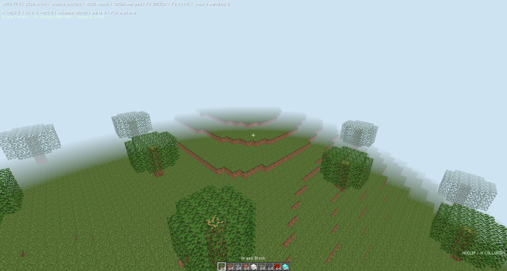
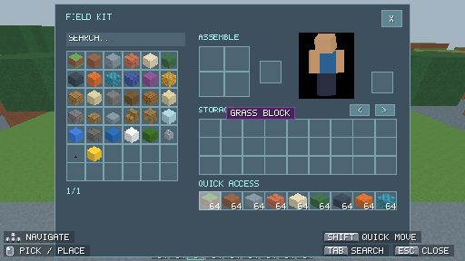
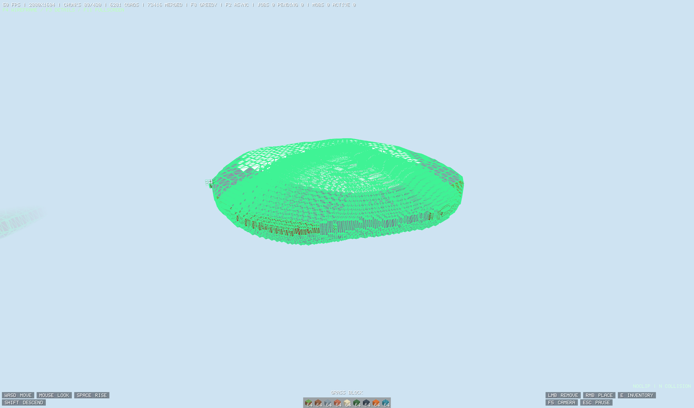

# Minecraft Rust Edition

A Rust voxel engine with editable block definitions, procedural worlds and
multiple rendering paths. Built as a foundation for an expandable block game.

## Screenshots



Terrain exploration in the Forward renderer. The gallery uses actual renderer
captures; the terrain and wireframe images are earlier verification scenes, while
the inventory image uses the current source. HUD FPS is an instantaneous sample.

| Inventory and GPU player preview | F4 triangle wireframe |
|---|---|
|  |  |

## Performance and triangle reduction

One recorded **current-source** production GPU fixture represents **6,557 exposed
faces with 2,452 greedy quads**: **62.6% fewer quads and terrain vertex bytes** than
separate exposed faces. Its cached nearby geometry is:

| Metric | Separate exposed faces (calculated) | Greedy mesh (captured) |
|---|---:|---:|
| Quads | 6,557 | 2,452 |
| Triangles | 13,114 | 4,904 |
| Terrain vertex payload | 1,573,680 bytes | 588,480 bytes |

The same frame reports **275,263 internal faces omitted** and **7 of 21 cached
nearby chunks drawn**, submitting **1,758 nearby triangles** after view/range
tests. These counts exclude distant LOD, actors and UI. The fixture ran offscreen
at 512 x 288 on an NVIDIA GeForce RTX 5070 Ti Laptop GPU through DX12; the
reference column is derived from its counters, not a fresh A/B timing run.

An earlier finite-court A/B benchmark reduced **39,172 to 3,212 triangles
(91.8%)**, with **3.7% higher measured event/present throughput** in that small
scene. Geometry savings and frame-rate gains are different measurements. See
[recorded performance data](docs/performance/metrics.json) for the raw counters
and run conditions. The earlier timing used ten-second ABBA runs with 120 warmup
frames; event/present intervals measure application throughput, not display
refresh rate or GPU execution time.

### How the engine saves work

| Algorithm / system | What it does | Implementation |
|---|---|---|
| Hidden-face removal | Tests neighboring block shapes and emits exposed surfaces, including across chunk boundaries. | [Shapes](crates/mcbe-client/src/engine/blocks/shapes.rs), [mesher](crates/mcbe-client/src/engine/render/mesh.rs) |
| Greedy rectangle meshing | Sweeps six directions through each 16-cubed chunk; combines compatible full opaque/cutout faces of the same block state. Texture coordinates repeat per block. | [Mesh construction](crates/mcbe-client/src/engine/render/mesh.rs) |
| Frustum and distance culling | Rejects chunk bounds outside the camera or range before submitting terrain draws. GPU back-face culling and depth testing handle surface visibility. | [Bounds tests](crates/mcbe-client/src/engine/render/mesh.rs), [draw selection](crates/mcbe-client/src/engine/render/gpu.rs) |
| Dirty mesh caching | Reuses uploaded chunk buffers and rebuilds affected/version-changed meshes instead of rebuilding the world every frame. | [GPU mesh cache](crates/mcbe-client/src/engine/render/gpu.rs) |
| Bounded asynchronous meshing | A worker builds owned 18-cubed halo snapshots; at most two jobs are in flight. Version/epoch checks reject stale work, and accepted uploads are paced. | [Worker scheduler](crates/mcbe-client/src/engine/render/meshing.rs) |
| Adaptive distant terrain | Recursively subdivides terrain patches with distance and boundary constraints; stitches shared edges and retains coarser geometry for far views. | [LOD generation](crates/mcbe-client/src/engine/render/distance.rs) |
| Readiness-based LOD handoff | Keeps fallback terrain until detailed GPU chunks are ready, with 240 ms detail fades and 180 ms distant-mesh crossfades. | [Coverage](crates/mcbe-client/src/engine/render/coverage.rs), [LOD cache](crates/mcbe-client/src/engine/render/distance.rs) |
| Compact chunk storage | Allocates dense chunks sparsely, stores block IDs in 16 bits and shares chunk snapshots with copy-on-write. A 16-cubed block-ID payload is 8 KiB before overhead. | [Voxel storage](crates/mcbe-client/src/engine/world/storage.rs) |
| Reused textures, instances and UI | Caches mipmapped textures and shared creature cuboids; uploads settled UI/player previews only when their inputs change. | [Textures](crates/mcbe-client/src/engine/render/texture.rs), [entities](crates/mcbe-client/src/engine/entities/), [UI renderer](crates/mcbe-client/src/engine/render/gpu_ui.rs) |
| Incremental optional ray scene | Reuses mesh-part hashes and vertex ranges; rebuilds at most two BLAS parts per frame within quality budgets. Forward remains the default. | [Ray renderer](crates/mcbe-client/src/engine/render/methods/ray/) |

For an **isolated, single-material solid 16 x 16 x 16 chunk**, independent cubes
would use 49,152 triangles. Removing internal faces leaves 3,072; merging its six
outer surfaces leaves just **12 triangles**. This is an idealized example, not a
whole-world benchmark. Partial blocks and translucent faces follow their own
geometry/sorting paths and do not all merge into those rectangles.

**Inspect it yourself:** F3 shows rendering counters, F4 toggles triangle edges,
F8 switches greedy/reference meshing, and F2 switches asynchronous/synchronous
meshing. Chunk culling currently uses camera/range bounds rather than GPU
occlusion queries or hierarchical-Z. Forward is the default; Deferred and
hardware ray-traced lighting are optional settings. Unsupported ray hardware
falls back to Deferred.

## Build and run

Use Windows 11 with a Rust toolchain supporting edition 2024 and the Visual Studio
C++ build tools/Windows SDK. The native renderer uses wgpu and Direct3D 12.

```powershell
git clone git@github.com:Mohammad-Ali-Haider/mcbe-rust.git
cd mcbe-rust
cargo run --release --locked
```

Open the cloned folder in VS Code and run commands from its terminal. Cargo uses
the project assets and continues the latest saved world, or generates one if no
save exists. The window opens maximized; F11 toggles borderless fullscreen.
Close the game before rebuilding its executable. Plain `cargo run` uses a slower
debug build.

```powershell
cargo new-world     # generate a fresh world
cargo original      # built-in colors without installed Minecraft textures
cargo test --workspace --locked
cargo fmt --all -- --check
```

Minecraft textures can be read from a local Windows installation. They are not
included in this repository; use `cargo original` to run without that installation.
World saves, preferences and build output are stored locally.

To run the compiled executable directly:

```powershell
cargo build --release --locked
.\target\release\mcbe-client.exe --engine --engine-home . --engine-continue
```

## Engine features

- Procedural biomes, caves, ravines, oceans and rivers; editable dimensions with
  separate world state and shared inventory.
- Walking, sprinting, sneaking, flight, noclip, swimming and wall traversal.
- Inventory, crafting, persistent furnaces, offhand items, measured buckets and
  water flow; keyboard/mouse and Xbox/XInput controller support.
- JSON block families, slab/stair states, glass, custom cuboid models and shared
  behavior/component systems; reload content with F6.
- Data-authored creatures, animation, personal skins, first/third-person views
  and a free camera.
- Settings for 2–255 chunk views, FOV, sensitivity, GUI scale, VSync and FPS limit.

Nearby blocks retain full collision and detail within 8 chunks. Far terrain uses
stitched surface geometry and progressive transitions. That approximation does
not fully represent caves, transparent buildings or edits to distant generated
trees. Very large viewing distances require more memory and preparation time.

## Controls

| Input | Action |
|---|---|
| WASD / mouse | Move / look |
| Space | Jump; double-tap toggles flight |
| F / N | Toggle collision flight / noclip |
| Shift / Ctrl | Sneak or descend / sprint |
| Left / right mouse | Remove / place or interact |
| Number keys / wheel | Select hotbar slot |
| E / Escape | Inventory / pause and settings |
| F5 / F11 | Camera perspective / borderless fullscreen |
| F3 / F4 | Render statistics / triangle wireframe |
| F6 | Reload content, UI and textures |
| Ctrl+S / F9 | Save / reload world |
| V / Alt+right mouse | Swap hands / use offhand |
| U | Dimension picker |
| T / slash | Local chat / commands |

Try `/give glass 64`, `/spawn cow` or `/travel islands`. Tab completes command
names. In water, Space rises, Shift dives and Ctrl swims faster. Hold C at a wall
to grip, W/S to climb, Ctrl plus movement to wall-run and Space to jump away.

## Source layout

| Path | Responsibility |
|---|---|
| [Client entry point](crates/mcbe-client/src/main.rs) | Window events, application state and frame loop |
| [Engine](crates/mcbe-client/src/engine/) | World simulation, movement, entities, UI and rendering |
| [Block system](crates/mcbe-client/src/engine/blocks/) | Typed components, registered behavior, block states and collision shapes |
| [Block definitions](content/base/blocks/) | One JSON definition per block family |
| [Models](content/base/models/) and [templates](content/base/templates/) | Reusable geometry and component defaults |
| [Crafting recipes](content/base/recipes/crafting.json) | Editable recipe data |
| [Core library](crates/mcbe-core/) | Shared physics, inventory and Bedrock data readers |
| [CLI](crates/mcbe-cli/) | Optional data inspection tools |
| [Development dependencies](requirements-dev.txt) | Python tooling for image and verification tasks |

Blocks share registered behaviors and reusable components rather than duplicating
placement, collision or rendering code per material. Rust traits provide behavior
interfaces; structs and enums compose the block state and components. Definitions,
models and behavior selection live in one content pack.

The vendored [wgpu-hal](vendor/wgpu-hal/) 25.0.2 dependency retains its MIT and
Apache-2.0 licenses. Its DX12 capability check accepts ray-tracing tiers at least
1.1, including tier 1.2 devices, while retaining the shader-model and feature
checks. Cargo selects this local patch through the workspace manifest.
